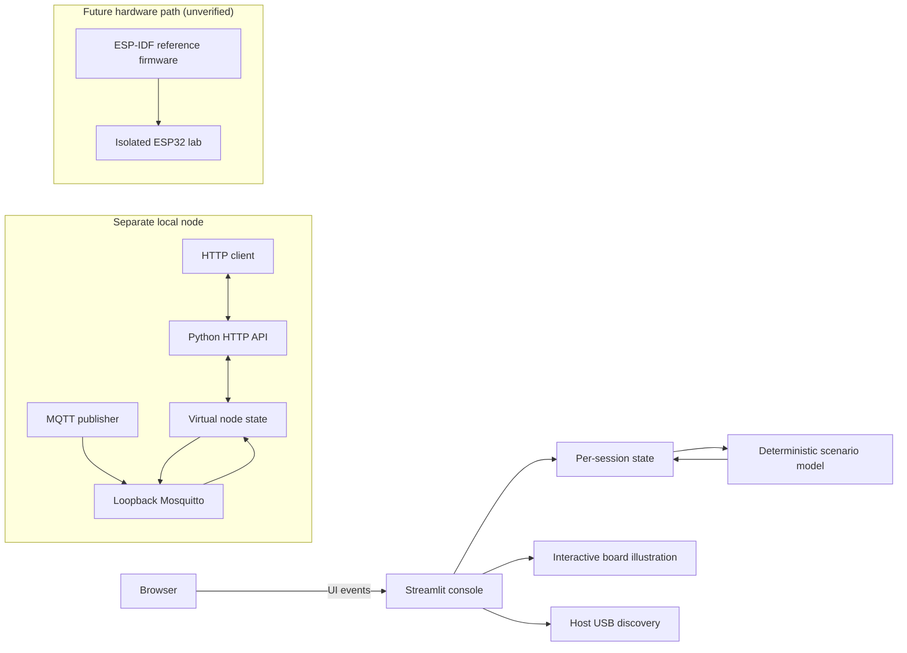

# SPECTRA-32

**A VIGIL-IoT Project** · **Security Platform for Embedded Cyber Threat Research & Analysis**

SPECTRA-32 is VIGIL-IoT's experimental attack-and-defense testbed for studying IoT vulnerabilities, secure communication, and cyber-physical resilience. Its research loop is **Build → Attack → Observe → Defend → Measure**. Experiments are limited to project-owned systems or explicitly authorized lab environments.

[](https://vigil-iot.github.io/VIGIL-Spectra-32/)
[](LICENSE)

[Open the interactive research workflow →](https://vigil-iot.github.io/VIGIL-Spectra-32/) · [Third-party notices](THIRD_PARTY_NOTICES.md)

## Status

| Area | Status |
|---|---|
| Streamlit console | Implemented session-local behavior model with board illustration, deterministic scenarios, counters, and event log |
| Python virtual node | HTTP/virtual LED routes implemented and covered by loopback tests; real broker integration not yet verified |
| USB chip discovery | Host-side serial discovery and explicit esptool chip-ID probe; physical probe not recorded |
| ESP-IDF firmware | Vulnerable classic ESP32 reference source only; no build or board validation recorded |
| Security experiments | Replay and T800 protocols are planned; no experiment runs or measured results exist |

Current maturity is **prototype / v0.1 software behavior model**. The console's Hardened profile and plotted counters are illustrative. They are not hardware measurements or evidence that a real defense works.

## What runs today

The Streamlit dashboard keeps its state in the current Streamlit session. Scenario actions update counters, virtual pin state, an event record, and the highlighted path. They do not call the Python node API or broker, send network traffic, write firmware, or control GPIO.

The optional Python node is a separate process with its own volatile virtual LED, loopback HTTP API, and MQTT client. Its default broker configuration listens only on `127.0.0.1`. It accepts repeated valid commands and does not implement authentication or replay prevention.

The Hardware view enumerates USB serial ports on the machine running the Python app. **Identify chip** is an explicit local action that may reset the board but does not erase or write flash. Streamlit Community Cloud cannot access USB devices attached to your computer. Current attack scenarios remain session-only and do not control the physical board.

## Architecture



See [the detailed architecture](docs/architecture.md), [requirements and scope](docs/requirements.md), [methodology](docs/methodology.md), and [known limitations](docs/limitations.md).

## Quick start: Streamlit console

Use Python 3.12, 3.13, or 3.14 with [uv 0.13.6](https://docs.astral.sh/uv/getting-started/installation/). The committed `uv.lock` resolves exact versions and package hashes for supported platforms. From the repository root:

```powershell
uv sync --locked
uv run --locked streamlit run simulator/dashboard/app.py
```

Open `http://127.0.0.1:8501`. The console does not require Mosquitto or the standalone node.

Run the automated tests:

```powershell
uv run --locked --group dev python -m unittest discover -s tests -v
uv run --locked --group dev python -m compileall -q data services components simulator tests tools
uv run --locked --group dev python tools/check_docs.py
```

The test suite uses a local loopback test server and Streamlit `AppTest`; it does not require a physical board or MQTT broker.

To run the same focused lint and dependency checks as CI:

```powershell
uv run --locked --group dev ruff check --select E4,E7,E9,F data services components simulator tests tools
uv run --locked --group dev pip-audit
```

## Optional local Python node

Install Mosquitto separately. Start the loopback-only broker in one terminal:

```powershell
mosquitto -c lab/simulation/mosquitto.conf
```

Start the node in another terminal:

```powershell
python simulator/vulnerable/basic_node.py
```

The page and REST API are available at `http://127.0.0.1:8080`. The API exposes `GET /api/state` and `POST /api/led` with exactly one `state=on` or `state=off` form value. MQTT command/status topics are `spectra/device01/cmd` and `spectra/device01/status`.

The HTTP model has route tests. The MQTT path has not had a broker-backed integration run in this repository. Do not change the sample broker to listen on a LAN interface for desktop simulation.

## Research and validation

- [Experiment 01: MQTT command replay](experiments/EXP-01-replay/README.md) — protocol design only; no run ledger entries.
- [Research analysis and paper selection](docs/research/RESEARCH_ANALYSIS.md)
- [Streamlit scenario catalog](docs/research/STREAMLIT_SCENARIO_CATALOG.md)
- [T800 reproduction plan](docs/research/T800_REPRODUCTION_PLAN.md) and [protocol](docs/research/T800_EXPERIMENT_PROTOCOL.md) — separate TCP port-scan paper track.
- [Benchmarks](docs/benchmarks.md) — no measurements reported; proposed metrics and method only.
- [Traceability matrix](docs/traceability.md) — connects requirements to evidence and verification status.
- [Repository engineering audit](docs/REPOSITORY_AUDIT.md) — baseline findings, changes, checks, maturity scores, and remaining limits.
- [SDG alignment](docs/sdg-alignment.md) — potential SDG 9.5 relationship only; no impact measured.

Never treat paper-reported results or session-model values as SPECTRA-32 measurements.

## Repository structure

```text
components/       Streamlit custom board component
data/             Sample node state, scenarios, and board metadata
services/         Session transitions and host-side chip identification
simulator/
  dashboard/      Streamlit app
  vulnerable/     Separate Python behavior model
  web/            Standalone node page
firmware/
  vulnerable/     Unverified classic ESP32 ESP-IDF reference source
  hardened/       Reserved for separate future firmware defenses
experiments/      Experiment definitions; no results yet
lab/              Loopback and future isolated-lab broker configurations
docs/             Architecture, requirements, protocols, limits, and research
tests/            Python unit, HTTP-route, and Streamlit UI tests
```

## Safety and limitations

The desktop broker and node are unauthenticated and loopback-only. Future hardware testing requires an isolated access point with no upstream connection, owned ESP32 hardware, and a reviewed run protocol. Do not expose the example broker or vulnerable firmware to a home, office, campus, public, or Internet-facing network. The initial hardware plan is limited to a board-verified low-voltage LED.

The software model does not emulate ESP32 radio, lwIP, GPIO timing, CPU, RAM, flash, or power. The board map is illustrative, and no hardened firmware or physical experiment is verified. See [Safety and data handling](docs/SAFETY_AND_DATA.md) and [SECURITY.md](SECURITY.md).

## Contributing and citation

Read [CONTRIBUTING.md](CONTRIBUTING.md) before opening a change. Report security issues using the process in [SECURITY.md](SECURITY.md). Cite the project using [CITATION.cff](CITATION.cff).

## License

SPECTRA-32-authored material is available under the MIT License in [LICENSE](LICENSE). The generated workflow diagram also includes third-party assets with separate notices; see [THIRD_PARTY_NOTICES.md](THIRD_PARTY_NOTICES.md).
