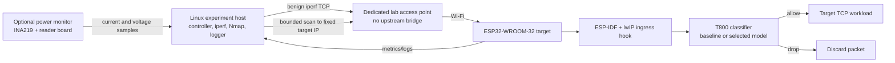

# SPECTRA-32 Testbed Architecture

**Planned first configuration:** reproduce the T800 inbound packet-filter experiment. This diagram describes a future setup; it is not an existing or tested system.

## Components

| Component | Role | First-stage boundary |
|---|---|---|
| Linux experiment host | Runs the experiment controller, benign iperf server, authorized scanner, serial/UDP log collection, and analysis | Configured to target one ESP32 address on the lab subnet only |
| Dedicated access point | Carries only experiment traffic | No internet, campus, office, or household uplink during experiments |
| ESP32-WROOM-32 / DevKit V1 | Target running the T800 filter and a small TCP workload | Use the board class from the paper before testing other ESP32 variants |
| T800 in ESP-IDF/lwIP | Examines incoming IP/TCP header data and makes the configured allow/drop decision | Keep upstream component separate and pin the modified ESP-IDF checkout |
| Optional INA219 reader | Measures power/current alongside device workload | Omit power conclusions if this measurement chain is unavailable |

## Traffic and measurement path

The host generates a benign TCP workload and a bounded port-scan workload, separately according to the experiment condition. The access point forwards that traffic to the ESP32. At the lwIP ingress path, T800 runs its selected classifier before the packet proceeds through the stack. The ESP32 and host collect performance data; the optional power monitor records current and voltage.

The original manual describes Python, ESP-IDF, iperf v2, and Nmap on the host, and a CSV output from the benchmark. Its power setup uses an INA219 and a second board. Match the upstream workflow where possible, but preserve exact local versions and deviations in each run record.

## What this architecture can and cannot test

The first architecture can test the selected **network-layer TCP port-scan** filtering behavior and its resource trade-offs. It does not inspect 802.11 radio frames before the ESP32 receives them, and the paper does not evaluate application-level MQTT replay, BLE, OTA updates, or web login behavior. Those need separate components and experiments later.

An LED or sensor can be added for a future cyber-physical demonstration, but it is not required to reproduce T800 and should not complicate the first benchmark.
