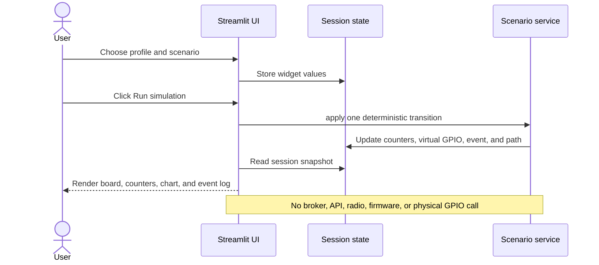
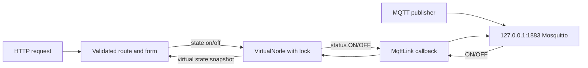

# SPECTRA-32 Architecture

**Status:** current architecture, checked against the repository on 2026-10-29. The software model and Streamlit console are implemented; the ESP-IDF firmware is a reference port that has not been built or flashed.

## System boundary

SPECTRA-32 currently has three distinct execution paths. The Streamlit console is an in-memory, per-session model. The standalone Python node is a separate loopback HTTP/MQTT process. The ESP-IDF source is a future hardware implementation. The dashboard does **not** connect to the node process, MQTT broker, or physical firmware for its security scenarios.

```mermaid
flowchart LR
  Browser[Browser] -->|UI interaction| App[Streamlit dashboard]
  App --> Session[Streamlit session state]
  Session --> Scenario[Scenario transition service]
  Scenario --> Session
  App --> Board[Interactive SVG board component]
  App --> Chart[Session counters and chart]
  App --> Serial[Host USB serial discovery]
  User[Explicit Identify chip click] --> Esptool[esptool ROM chip-id probe]
  Serial --> User
  Esptool --> App

  subgraph Separate local software node
    HttpClient[Local HTTP client] <--> Http[Python HTTP server]
    Publisher[Local MQTT publisher] --> Broker[Loopback Mosquitto]
    Broker --> Mqtt[MqttLink in Python node]
    Http <--> State[VirtualNode state]
    Mqtt <--> State
  end

  subgraph Future hardware path — unverified
    Firmware[ESP-IDF vulnerable reference firmware] -->|Wi-Fi| LabAP[Isolated lab AP]
    LabAP --> LabBroker[Lab MQTT broker]
    LabAP --> DeviceHTTP[Device HTTP server]
  end
```

The console and standalone node are intentionally separate. Values shown in the dashboard are sample or session-only values; they are not telemetry from the Python node or ESP32. The standalone node's virtual LED and MQTT counters do not feed the Streamlit chart.

## Components and source map

| Component | Source | Responsibility | Current status |
|---|---|---|---|
| Streamlit application | `simulator/dashboard/app.py` | Navigation, security profile and scenario controls, component details, metrics, event list, chart, and hardware page | Implemented; AppTest smoke coverage |
| Session state | `data/device_state.py` | Versioned sample state, board pins, sample event | Implemented; values are illustrative |
| Scenario catalog | `data/scenarios.py` | Scenario labels, descriptions, profile outcomes, legacy widget-label migration | Implemented |
| Scenario transitions | `services/simulator.py` | Mutates only the session model and retains at most 60 events | Implemented; deterministic simulation |
| Board reference | `data/board_definition.py`, `components/board.py`, `components/board_component/index.html` | Pin metadata and accessible selectable SVG board | Implemented; representative DevKit-style layout |
| Host chip identification | `services/hardware.py` | Lists serial ports and runs an explicit esptool ROM `chip-id` probe | Implemented; local-host only, no flash write/erase command |
| Standalone node | `simulator/vulnerable/basic_node.py` | Virtual LED state, HTTP API, optional MQTT command/status link | Implemented in source; MQTT service not verified in this audit |
| Broker configuration | `lab/simulation/mosquitto.conf` | Anonymous broker bound to `127.0.0.1` for desktop simulation | Implemented; requires Mosquitto to run |
| ESP-IDF reference | `firmware/vulnerable/basic-node/` | Classic ESP32 station, HTTP LED endpoints, MQTT client, configurable LED GPIO | Source present; build and hardware behavior unverified |
| Experiment protocols | `experiments/`, `docs/research/` | Planned MQTT replay study and separate T800 reproduction | Protocols only; no runs recorded |
| Pages diagram | `.github/workflows/deploy-workflow-page.yml`, `docs/site/workflow/` | Builds and publishes a static workflow diagram with an explicit file allowlist | Workflow defined; deployment after the latest source change was not run in this audit |

## Streamlit scenario flow



The dashboard's **Hardened** option is a comparison profile in `services/simulator.py`. It changes modeled policy flags and event outcomes; it does not install or exercise a real defense. `MQTT without TLS`, replay, authentication, rate, OTA, and debug scenarios likewise update only this session state.

## Standalone software node

The optional node process binds its HTTP server to `127.0.0.1` and its MQTT client connects to `127.0.0.1:<port>`. The default broker configuration listens only on loopback. The HTTP handlers accept `GET /`, `GET /api/state`, and a bounded `POST /api/led` form with exactly one `state=on` or `state=off` value. MQTT accepts `ON` and `OFF` on `spectra/device01/cmd` and publishes state to `spectra/device01/status`.



The model is application-level behavior simulation, not ESP32 emulation. It does not model Wi-Fi, lwIP, timing, processor load, memory, flash, or power.

## Hardware discovery and future firmware

The **Hardware** view enumerates serial ports on the machine running the Streamlit Python process. Port enumeration does not open/reset the board. Only after a user selects **Identify chip** does the server run `python -m esptool --port <selected-port> --baud 115200 --no-stub chip-id`. The result classifies classic ESP32 targets as supported and other Espressif chips as unsupported in this milestone. This identification call may reset a board but contains no flash-write or erase operation. A Streamlit Cloud server cannot see USB devices attached to a user's computer.

The ESP-IDF reference firmware is a separate implementation path. It would join a configured isolated WPA2 lab network, serve unauthenticated HTTP endpoints, connect to an unauthenticated MQTT broker, and control a configured low-voltage LED GPIO. It has no application authentication, HTTPS, MQTT credentials/TLS, replay defense, or signed OTA implementation. Those missing controls are deliberate in the vulnerable baseline and make it unsafe for an untrusted network. It is not built or hardware-verified.

## Deployment view

| Deployment | What runs there | Network/hardware boundary |
|---|---|---|
| Local console | Python, pinned Streamlit dependencies, browser UI | `.streamlit/config.toml` binds the server to loopback; local serial discovery sees this host only |
| Streamlit Community Cloud | Same UI and session model | Cloud host cannot discover a user's local USB board; no physical telemetry or attack path is implemented |
| Optional desktop node | Python HTTP node and optional Mosquitto | Both are configured for loopback in the software-only milestone |
| Future hardware lab | ESP-IDF firmware, isolated AP, broker, host | Not yet built or validated; see `lab/README.md` and `docs/SAFETY_AND_DATA.md` |
| Workflow diagram site | Static files assembled by GitHub Actions and GitHub Pages | Explicit allowlist only; not the simulator or a hardware control surface |

## Trust boundaries and protocol facts

- The vulnerable Python service and firmware accept unauthenticated virtual/physical LED commands by design. Keep the desktop broker on loopback and the future broker on a dedicated lab-only interface.
- The browser-to-dashboard path changes the Streamlit session model. It does not send attack traffic.
- Host USB discovery is distinct from browser Web Serial. It runs on the Python host and chip identification requires an explicit action.
- The dashboard's profile flags are not measurements, and its chart is not a hardware sensor plot.
- The current application does not establish a trust relationship between Streamlit and the standalone node. Adding one requires an explicit protocol and authentication design.

## Related design records

- [Requirements and scope](requirements.md)
- [Implementation and experiment methodology](methodology.md)
- [Traceability matrix](traceability.md)
- [Known limitations](limitations.md)
- [ADR-001: Keep the software behavior model separate from firmware](decisions/ADR-001-software-model-boundary.md)
- [ADR-002: Keep dashboard security scenarios session-local](decisions/ADR-002-session-local-scenarios.md)
- [ADR-003: Identify chips through an explicit host-side esptool probe](decisions/ADR-003-host-chip-identification.md)
